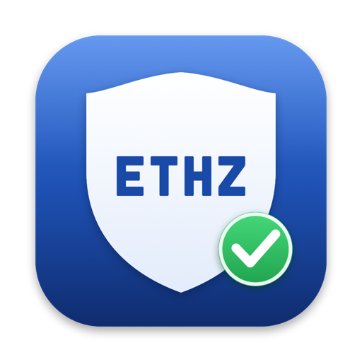

<p align="center">
  
</p>

<h1 align="center">ETHZ VPN</h1>

<p align="center">One click to the ETH Zurich VPN from the macOS menu bar, secured with Touch ID.</p>

ETHZ VPN wraps [OpenConnect](https://www.infradead.org/openconnect/) so you never have to type your password or a one-time code again. Your WLAN password and OTP secret are encrypted with a key in your Mac's Secure Enclave, the app generates the TOTP code itself, and only Touch ID unlocks them for a connection.

Not affiliated with or endorsed by ETH Zurich.

## Features

- **Menu bar status.** An ETHZ badge that turns green when connected, plus a live status card with your VPN IP and connection time.
- **Touch ID instead of typing codes.** Your secrets can only be decrypted after Touch ID (or your Mac password), so an unlocked Mac alone is not enough.
- **Clear errors.** Failed logins, unreachable servers and setup problems show a readable message, and the full log can be copied from the menu.
- **Profiles.** Separate profiles for `student-net`, `staff-net` or other realms. Right-click (or Control-click) the badge to toggle the default profile.
- **Connect at login.** Combine *Launch at Login* and *Connect at Launch* to be on the VPN right after you log in.
- **CLI.** `ethz-vpn connect` from the terminal, with the same profiles and Touch ID prompt.

## Install

1. Download `ETHZ VPN.dmg` from [Releases](https://github.com/lionnus/ethz-vpn/releases) and drag the app to `/Applications`.
2. The app is not notarized, so remove the quarantine flag once:
   ```bash
   xattr -dr com.apple.quarantine "/Applications/ETHZ VPN.app"
   ```
3. Open the app. The profiles window appears on first launch.

## Setup

Add a profile with:

| Field | Value |
|---|---|
| Username | Your ETH username, without `@ethz.ch` |
| WLAN Password | Your ETH network password |
| OTP Secret | The secret key from your ETH authenticator enrollment. Paste the base32 key (for example `JBSW Y3DP ...`) or the whole `otpauth://` link from the QR code. |
| Realm | `student-net` (default), `staff-net`, or your group |

On the first save, macOS asks once for your administrator password to install the VPN helper. After that, connecting only needs Touch ID.

## How it works and security

OpenConnect needs root to create the tunnel. A one-time install puts a small helper and copies of `openconnect` and `vpnc-script` into `/Library/PrivilegedHelperTools/ethz-vpn/`, owned by root. A sudoers rule lets your account run only that helper without a password.

- The helper accepts only `connect`, `disconnect` and `version`, validates every argument, and runs OpenConnect with fixed options. It cannot be used to run other commands as root.
- Your password and OTP secret are passed to the helper on stdin. They never appear in process arguments or user-writable files.
- Secrets are encrypted to a Secure Enclave key that requires Touch ID or your Mac password for every use. The Keychain only holds ciphertext, so neither someone at your unlocked Mac nor malware running as your user can read them without you approving the prompt. The key never leaves this Mac.
- Saved secrets are never shown in the app again.

Saving the OTP secret on your Mac turns the Mac, together with your fingerprint, into your second factor.

## CLI

```bash
ln -s "$(pwd)/ethz-vpn.sh" /usr/local/bin/ethz-vpn
```

```
ethz-vpn connect [profile]   Connect (default profile if omitted), asks for Touch ID
ethz-vpn disconnect          Disconnect
ethz-vpn status              Show connection status
ethz-vpn profiles            List profiles
```

Profiles are managed in the app. Connecting runs the app binary, since only it can unlock the secrets.

## Troubleshooting

- **"Could not reach sslvpn.ethz.ch"** while other sites work: another VPN client may be holding routes. Quit it and retry.
- **"Login failed"**: check the username, WLAN password, realm, and that your Mac's clock is set automatically (TOTP codes depend on it).
- **Details**: *Copy Connection Log* in the menu, or
  `log show --last 10m --predicate 'subsystem == "com.dcamenisch.ethz-vpn-menubar"'`.

## Build from source

```bash
brew install openconnect dylibbundler
make fetch-openconnect   # bundle openconnect, its libraries and vpnc-script
make install             # build into ~/Applications/ETHZ VPN.app
make dist                # signed DMG in dist/
```

With only the Command Line Tools installed (no Xcode), point the build at an SDK whose SwiftUI macros ship with them, e.g. `SDKROOT=/Library/Developer/CommandLineTools/SDKs/MacOSX26.5.sdk make install`.

## Uninstall

```bash
make uninstall
security delete-generic-password -a "$USER" -s eth-vpn-password-<profile-id>
security delete-generic-password -a "$USER" -s eth-vpn-token-<profile-id>
security delete-generic-password -a "$USER" -s eth-vpn-enclave-key
rm -rf ~/.local/share/ethz-vpn-connect
```

## License

Changes in this fork are MIT licensed, see [LICENSE](LICENSE). The original code by Danny Camenisch has no license; see [NOTICE](NOTICE) for details and third-party licenses.
